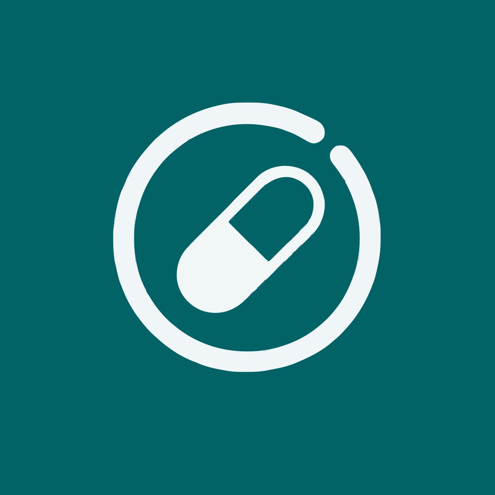
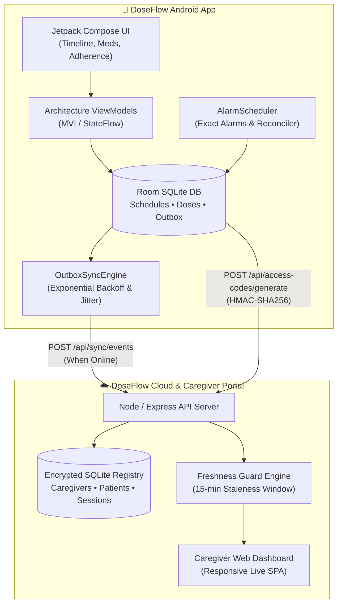

<p align="center">
  
</p>

<h1 align="center">DoseFlow</h1>

<p align="center">
  <strong>Intelligent, offline-first medication adherence for patients & real-time zero-trust monitoring for caregivers.</strong>
</p>

<p align="center">
  <a href="#-key-features"></a>
  <a href="#-architecture"></a>
  <a href="#-zero-trust-freshness-guard"></a>
  <a href="#-quick-start"></a>
</p>

---

## 🌟 Overview

**DoseFlow** is designed around a single medical premise: *missed medications shouldn't happen because of poor software, lost network connections, or aggressive OS battery savers.*

Built as a native Android application paired with a modern real-time caregiver web dashboard, DoseFlow guarantees dose delivery offline while giving family members and healthcare providers audited adherence insight with strict data freshness guarantees.

```
       PATIENT DEVICE                                     CAREGIVER DASHBOARD
 ┌──────────────────────────┐                      ┌──────────────────────────────┐
 │   Android Native App     │                      │   Real-Time Web Portal       │
 │  • Jetpack Compose M3    │    HMAC Pairing      │  • Live Dose Timeline        │
 │  • Local Room SQLite     │ ───────────────────> │  • 7 & 30-Day Adherence      │
 │  • Exact Alarms Engine   │   Outbox Sync Hub    │  • Clinical CSV Export       │
 │  • Zero-Network Core     │                      │  • Strict Freshness Guard    │
 └──────────────────────────┘                      └──────────────────────────────┘
```

---

## ✨ Key Features

### 📱 Patient Mobile Experience (Android Native)
* **100% Offline Resilience:** Dose schedules, occurrence calculations, and dose confirmation records live in local Room SQLite. No network required to trigger alarms or record doses.
* **Exact Alarm Guarantee:** Uses `AlarmManager.setExactAndAllowWhileIdle` to bypass Android Doze Mode and background execution limits.
* **Smart Reconciliation:** Idempotently handles DST shifts, timezone travels, phone reboots (`BOOT_COMPLETED`), and system time adjustments without duplicate alarms.
* **Actionable Notification Actions:** Single-tap `Take`, `Skip`, or `Snooze (+10m)` directly from the lock screen.
* **Auto-Escalation Engine:** Automatically escalates neglected doses at +15 minutes and transitions unacknowledged doses to missed at +45 minutes.

### 🌐 Remote Caregiver Portal (Web App)
* **Zero-Trust Freshness Guard:** If a patient's mobile phone goes offline for >15 minutes, unconfirmed doses are instantly labeled **"Awaiting Sync"** rather than assumed taken.
* **Instant Pairing:** Patient taps *Share Caregiver Code* on phone &rarr; Caregiver enters 6-character code &rarr; Connected immediately worldwide.
* **Adherence Gauges:** Dynamic 7-day and 30-day compliance tracking calculated straight from cryptographic event logs.
* **Physician Export:** One-click CSV export ready for medical appointments and clinical audits.

---

## 🔬 System Architecture



---

## 🛡️ Zero-Trust Freshness Protocol

Medical monitoring applications often dangerously display old data as if everything is fine. DoseFlow implements a **Zero-Trust Freshness Contract**:

| Device Sync Heartbeat | Portal Display State | Dose Treatment |
| :--- | :--- | :--- |
| **< 15 minutes** | 🟢 **Live Synced** | Normal schedule display with live status |
| **> 15 minutes** | 🟡 **Offline Stale Warning** | Unconfirmed doses flagged as *Awaiting Sync* |
| **> 12 hours** | 🔴 **Prolonged Disconnect** | Red banner prompting phone check-in |

> [!NOTE]  
> Under stale conditions, caregivers are visually notified that the device is offline, preventing incorrect assumptions about whether a dose was actually taken.

---

## 🚀 Quick Start

### Prerequisites
* **Android Studio Ladybug (or newer)** with Android SDK 34+
* **JDK 17+**
* **Node.js 18+**

### 1. Build the Android App
You can build the APK directly with a single command:

```bash
# Build debug APK with instant console feedback
npm run apk
```

The resulting binary will be ready at:
`app/build/outputs/apk/debug/app-debug.apk`

### 2. Launch Caregiver Portal Locally
```bash
# Start the web portal server
npm run portal
```
Open **[http://localhost:3000](http://localhost:3000)** in your browser to access the caregiver dashboard.

---

## 🧪 Testing & Quality Assurance

DoseFlow maintains a comprehensive unit and integration test suite across both Android and backend services:

```bash
# Run Android Unit & Architecture Tests (75+ tests)
./gradlew testDebugUnitTest

# Run Android Compose UI & Instrumentation Tests
./gradlew compileDebugAndroidTestKotlin

# Run Caregiver Portal & Cryptographic Security Tests
cd doseflow-portal && npm test
```

---

## 🔒 Security & Privacy

* **Hashed Code Registry:** Access codes generated on the patient's device are hashed server-side with HMAC-SHA256. Plaintext access codes are never stored as primary registry keys.
* **Read-Only Remote Model:** Caregivers have strict read-only observation rights. Dose alterations and schedule changes can **only** be executed physically on the patient's primary device.
* **Zero Bloat:** Completely clean of tracking pixels, advertising SDKs, and third-party analytics.

---

## 📁 Repository Structure

```
DoseFlow/
├── app/                        # Android Native Application
│   ├── src/main/java/          # Jetpack Compose UI, Room DB, Alarm Scheduler
│   ├── src/main/res/           # Material themes, vector drawable assets, icons
│   └── src/test/               # Exhaustive unit test suite (Alarm, Zone, Sync)
├── doseflow-portal/            # Caregiver Remote Dashboard & Sync Backend
│   ├── data/                   # SQLite database directory (clean, zero demo rows)
│   ├── public/                 # Caregiver SPA (HTML, CSS, JS, SVG assets)
│   ├── server.js               # Express API (Sync, Pairing, Auth, Dashboard)
│   └── test/                   # API integration & crypto verification tests
├── logo.svg                    # Official DoseFlow Vector Mark
├── build-apk.js                # One-command CLI build runner
└── package.json                # Project script definitions
```

---

<p align="center">
  Crafted with care for patient wellness and caregiver peace of mind. ❤️
</p>
